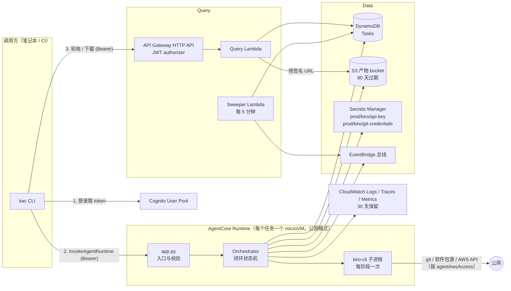
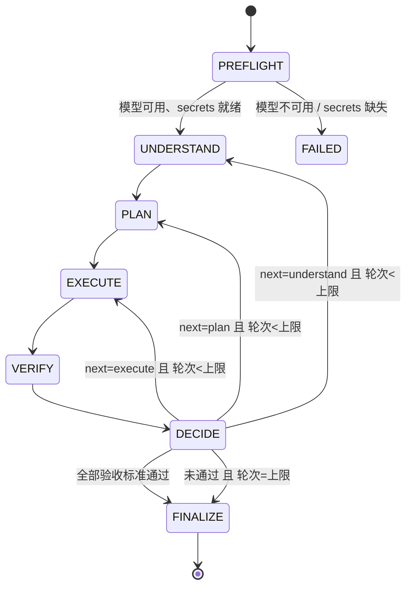
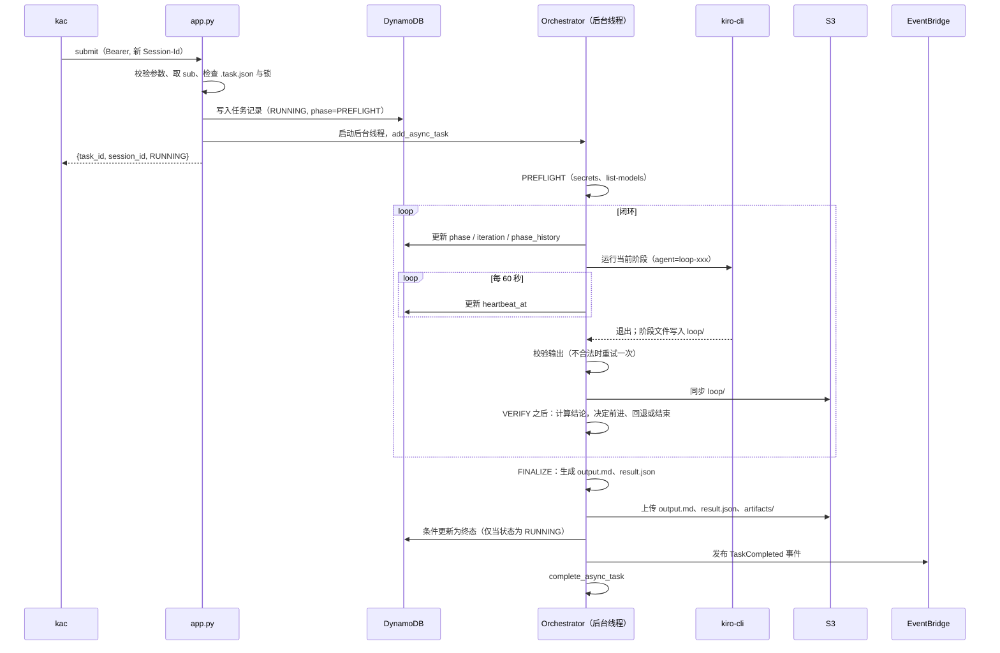
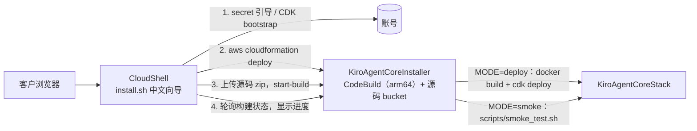

# 设计文档：kiro-cli on AWS AgentCore

## 概述

整体由五部分组成：

1. **Runtime 容器**：部署在 AgentCore Runtime 上的 Python 服务。接收提交请求后立即返回，由后台的 **Orchestrator（编排器）** 驱动闭环：每个阶段运行一次 `kiro-cli chat --no-interactive`，阶段之间通过工作区文件交接，由代码根据验证结果决定前进、回退还是结束。结果写入 S3 和 DynamoDB，并发布 EventBridge 事件。
2. **Query API**：API Gateway HTTP API + Lambda，提供任务查询、任务列表和产物下载链接。
3. **Sweeper**：定时运行的 Lambda，把因 Session 被回收而无人更新的 `RUNNING` 任务标记为 `FAILED`。
4. **Cognito**：统一签发 token，Runtime 和 Query API 都用它鉴权。
5. **kac**：本地 Python CLI，封装配置、登录、提交、轮询和下载。

另外提供前置配置脚本 `scripts/bootstrap.sh`，引导管理员准备 secrets 和部署工具。全部基础设施由一个 CDK (TypeScript) stack 定义，部署到 `us-east-1`。

## 架构



## 关键设计决策

### D1：闭环由代码驱动，每个阶段运行一次独立的 kiro-cli

本地 kiro-cli 2.35.2 的 `chat` 子命令提供以下参数：`--no-interactive`、`--output-format stream-json`、`--trust-all-tools`、`--model`、`--effort`、`--agent`。每个阶段运行一次 kiro-cli，使用该阶段专用的 agent 配置（系统提示）。阶段的输入和输出都是工作区中约定路径下的文件，Orchestrator 读取并校验这些文件后决定下一步。

这样做的效果：

- **顺序和回退由代码强制执行**：模型无法跳过验证，也无法自己宣布完成。是否通过由 Orchestrator 根据验证报告逐条计算。
- **验证使用独立上下文**：验证阶段是一次全新的 kiro 运行，看不到执行阶段的对话，只能通过实际检查工作区得出结论。
- **不依赖 kiro 会话恢复**：所有跨阶段的信息都在文件里，过程可审计，也会上传到 S3。
- **超时和清理简单**：每个阶段是一个子进程，超时直接 kill 进程组。

代价是每个任务至少运行 4 次 kiro-cli，credit 消耗约为单次执行的数倍，阶段切换也会带来几秒的启动开销。

### D2：结构化文件交接，并由代码校验

每个阶段都输出两类文件：一个 Markdown 文件给人看，一个 JSON 文件给代码读。Orchestrator 用 pydantic 模型校验 JSON，并做以下跨文件一致性检查：

| 检查 | 规则 |
|---|---|
| 调用方提供的验收标准 | 必须原样出现在 `requirements.json` 中（编号 `U-n`），不能被删改 |
| 推导的验收标准 | 编号 `D-n`，至少一条（调用方没有提供时） |
| 计划覆盖 | 每条验收标准至少有一个计划步骤关联，并且有验证方法；步骤引用的编号必须存在 |
| 验证完整性 | 验证报告必须对每一条验收标准给出结论，且证据非空 |
| 整体结论 | 由代码计算：全部 `pass` 才算通过。模型给出的整体结论只作参考 |

校验失败时，Orchestrator 把错误说明附到 prompt 中，重试该阶段一次。重试后仍失败，任务以 `FAILED` 结束（`error_code=PHASE_OUTPUT_INVALID`）。

### D3：需求澄清由 agent 自行完成

需求理解阶段的系统提示要求 agent 按以下顺序处理不明确之处：

1. 重新阅读 prompt 和 context。
2. 阅读相关仓库内容，比如 README、现有代码、测试和配置。
3. 仍无法确定时，选择影响面最小、最保守的假设。

每条假设记录在 `requirements.json` 的 `assumptions` 中，包括内容、依据和影响。验证阶段如果判定失败原因是需求理解有误，会在反馈中指出相关的假设编号。回到需求理解阶段后，agent 必须修正或替换这些假设，并写明修改原因。Orchestrator 会对比前后两版 `requirements.json`，在 `assumption_history.json` 中记录每次修改。

### D4：一个 Session 只运行一个任务

由于不支持追问，每个任务都使用一个新的 AgentCore Session。kac 生成 `kac-` 前缀加 UUID4 的 session ID（40 个字符，满足至少 33 个字符的要求），放在请求头 `X-Amzn-Bedrock-AgentCore-Runtime-Session-Id` 中。容器内用两层防护保证只运行一个任务：

- 进程内的锁：有任务正在运行时，新请求返回 `SESSION_BUSY`（409）。
- 标记文件 `/workspace/.task.json`：已运行过任务的 microVM 拒绝新任务，同样返回 409。

由于不会复用 Session，不需要 Sessions 表，也不需要做归属校验：别人即使猜中 session ID，请求也只会被拒绝。

Runtime 的生命周期配置：`idleRuntimeSessionTimeout=300`（任务结束 5 分钟后回收 microVM，减少空闲成本），`maxLifetime=28800`（8 小时）。

### D5：异步执行，并通过 `/ping` 保持 Session 存活

使用 `bedrock-agentcore` Python SDK 的 `BedrockAgentCoreApp`：

- `@app.entrypoint` 只做参数校验和建档，然后启动后台线程，立即返回。
- 后台线程开始时调用 `app.add_async_task()`，结束时调用 `app.complete_async_task()`。SDK 据此让 `/ping` 返回 `HealthyBusy`，Session 不会因空闲超时被回收。
- 入口函数内不做阻塞操作，避免阻塞 `/ping`。

### D6：调用方身份从 JWT 中获取

Runtime 配置 `requestHeaderAllowlist: ["Authorization"]`，容器代码就能读到原始 bearer token。该 token 已由 AgentCore 的 inbound authorizer 验证过签名、签发方、有效期和 `client_id`，容器内只解码 payload，取 `sub` 作为所有者。Cognito 的 client_credentials token 中 `sub` 等于 `client_id`，所以人类用户和系统调用方可以统一处理。

### D7：凭证只注入 kiro 子进程，并对输出做脱敏

- Secrets 在任务开始时读取一次，以环境变量形式只传给 kiro-cli 子进程，不写入 wrapper 自身的环境变量。
- wrapper 的日志、任务记录中的文本字段、上传到 S3 的所有文本文件，在写出前都会把已知 secret 的值替换为 `***REDACTED***`。
- 在 `--trust-all-tools` 下，agent 本身能读到这些环境变量，所以脱敏只能防止凭证意外出现在输出中，防不了恶意外传（见“已知风险”）。

### D8：调用方的 Kiro 配置随任务同步，合并进阶段 agent

- `kac submit --kiro-dir` 只打包白名单内的路径（`settings/mcp.json`、`skills/`、`steering/`、`agents/`），生成确定性的 gzip tar，base64 后放在提交请求的 `kiro_config` 字段中；`--agent` 放在 `kiro_agent` 字段中。
- Runtime 在提交时于内存中解析并校验（不使用 `tarfile.extract`），PREFLIGHT 时写入 `~/.kiro`。每个任务都在新的 microVM 中运行，所以配置之间互不影响。
- 自定义 agent 默认不加载 skills、steering 和 `mcp.json`，所以必须为每个任务重新生成 4 个阶段 agent：`resources` 增加 `file://~/.kiro/steering/**/*.md` 和 `skill://~/.kiro/skills/*/SKILL.md`，设置 `includeMcpJson: true`，`tools` 增加每个启用的 server 的 `@name`。以上行为已在 kiro-cli 2.35.2 headless V3 下实测确认。
- `--agent` 不替换阶段 agent，只合并 prompt（追加在闭环规则之后）、`mcpServers`、MCP 工具选择器和 `resources`；内置工具集、模型和 hooks 仍由闭环决定。
- kiro-cli 会静默跳过启动失败的 MCP server，并把未设置的 `${VAR}` 原样传递，所以 kac 在提交前、Runtime 在 PREFLIGHT 都会检查并给出警告。
- wrapper 以 `opentelemetry-instrument` 启动，会设置 `OTEL_*` 并把 auto-instrumentation 的 `sitecustomize` 放进 `PYTHONPATH`。这些变量被子进程继承后，会让其他 Python 环境中的程序崩溃（实测 `uvx mcp-server-fetch` 报 `Propagator xray not found`），所以 kiro-cli 及其启动的 MCP server、shell 命令使用去掉这些变量的环境（`kiro_runner.child_env`）。

### D9：闭环模式可选，subagent 模式下流程仍由代码控制

- `none`（默认）：不走闭环，`loop-direct` agent 运行一次 kiro-cli（共用硬性规则：不提问、不做 AWS 写操作、不输出凭证；没有交接 JSON 协议）。消息中直接给出 prompt、context 和验收标准，验收标准由 agent 自查、不做独立验证。kiro-cli 正常结束即 `SUCCEEDED`，阶段历史只有一条 `RUN`，报告包含最终回答，验收标准标为 `not_verified`。同步的 kiro 配置同样合并进 `loop-direct`。
- `process`（默认）：每个阶段一个 kiro-cli 进程，`Orchestrator._run_phase` 通过 `KiroRunner` 运行。
- `subagent`：只运行一个 kiro-cli，agent 为 `loop-orchestrator`（只有 `shell` 和 `subagent/loop-*` 工具，模型取 `ORCHESTRATOR_MODEL` 中第一个可用的）。`_loop` 在后台线程中照常运行，阶段执行器换成 `SubagentBridge`：每个阶段的消息写入 `loop/tasks/NNN-<agent>.md`，调度 agent 通过 `python -m kiro_runtime.loopctl next`（本地 Unix socket，每个任务一个 token，JSON 行协议，不用 pickle）取得要调用的 sub-agent 和任务文件；下一次调用表示上一阶段结束，编排器随即校验其结果。阶段 agent 把 JSON 写到消息指定的文件（sub-agent 的回复只会交给调度 agent）。
- 握手规则：阶段只有在它的回答文件存在时才算完成；在此之前收到的 `next` 会拿回同一个请求并被要求重新调用 sub-agent（最多 2 次，之后交给校验处理）。每次尝试使用独立的回答路径 `loop/answers/<phase>-<轮次>-<尝试>-<随机串>.json`，被接受后改名为正式交接文件，迟到的写入不会影响已接受的结果。回复无法送达时撤销这次发放。没有新请求时 `next` 返回 `wait`，只有闭环结束才返回 `done`。sub-agent 功能（`chat.enableSubagent`）只在 subagent 模式的任务中于运行时打开。
- 因此两种模式共用全部闭环规则：顺序、回退、轮次、交接校验和重试、验证前隐藏执行报告并检查被跟踪文件、最终结论由代码计算。调度 agent 提前结束时任务以 `ORCHESTRATOR_STOPPED` 失败。
- 实测 subagent 模式更慢、更贵（简单任务 58 秒对 26 秒，小型代码任务 99 秒对 42 秒，credits 约 2 倍；原因是调度 agent 自身的推理轮次和 sub-agent 启动开销，而阶段之间是串行依赖，无法并行），所以默认使用 `process`。
- 已知边界：phase agent 与编排器以同一系统用户运行，恶意的 agent 本来就能伪造交接文件；代码校验防的是出错的 agent，不是恶意的 agent。真正的隔离需要让 agent 以不同用户运行、`/workspace/loop` 只允许编排器写入（两种模式相同）。

## 闭环状态机



规则：

- **轮次**：每进入一次 EXECUTE，轮次加 1。从 VERIFY 回退到 PLAN 或 UNDERSTAND 时，都会接着进入新的 EXECUTE，所以任何回退都消耗一轮。
- **回退目标**：由验证报告的 `next` 字段建议（`execute` / `plan` / `understand`）。缺失或不合法时，默认回到 `execute`。
- **反馈传递**：Orchestrator 把最近一次验证报告中未通过的条目和反馈写入 `loop/feedback.json`，作为回退目标阶段的输入。
- **终态**：FINALIZE 根据结论设定状态：全部通过为 `SUCCEEDED`，达到上限仍未通过为 `INCOMPLETE`。任何阶段出现不可恢复的错误，都会跳到 FINALIZE，并设为 `FAILED` 或 `TIMED_OUT`。
- **PREFLIGHT**：每个任务都在新的 microVM 中运行，所以每次都会读取 secrets，并运行 `kiro-cli chat --list-models -f json`，确认请求的模型对当前 API key 可用；未指定模型时，按 `DEFAULT_MODEL` 优先级列表选第一个可用且被允许的模型，并写回任务记录。失败时任务以 `FAILED` 结束（`error_code=MODEL_UNAVAILABLE` / `SECRET_UNAVAILABLE` / `KIRO_AUTH_FAILED`）。
- **FINALIZE 不调用 kiro-cli**：最终报告由代码根据各阶段文件按模板生成，保证内容和过程文件一致。

### 各阶段约定

交接方式（精简交接）：Orchestrator 把输入文档以紧凑 JSON 的形式**直接写在阶段消息里**；单个文档超过 24 KiB、或总量超过 64 KiB 时改为给出文件路径。消息作为一个命令行参数传给 kiro-cli，Linux 对单个参数限制为 128 KiB，所以整条消息控制在 120 KiB 以内，超出时先改为全部引用路径，再截短重试说明。阶段**在最终回复里用一个 ```json 代码块给出结果**，不自己写交接文件，也不自己校验；Orchestrator 校验通过后写入 `.json`，并由代码渲染 `.md`（`render.py`）。实测每个阶段减少 2–4 轮模型往返：简单任务从 45 秒降到 26 秒，小型代码任务从 66 秒降到 42 秒，credits 减少约 40%。

| 阶段 | agent 配置 | 输入（写在消息里） | 输出（回复中的 JSON，由 Orchestrator 落盘） | 要点 |
|---|---|---|---|---|
| UNDERSTAND | `loop-understand` | `input.json`；回退时还有 `feedback.json` 和上一版 `requirements.json` | `requirements.json`（`.md` 由代码渲染） | 可以 clone 和阅读仓库，不修改代码；自行澄清并记录假设（D3）；推导标准（D-n）最多 3 条，必须可客观检查、不能与调用方标准或硬性规则冲突，超过 5 条会被驳回 |
| PLAN | `loop-plan` | `requirements.json`；回退时还有 `feedback.json` | `plan.json` | 步骤关联验收标准；为每条验收标准给出验证方法 |
| EXECUTE | `loop-execute` | `requirements.json`、`plan.json`；第 2 轮起还有 `feedback.json` | 工作区改动、`iterations/<n>/execution.json` | 按计划执行；记录偏离计划之处；最终交付物写入 `ARTIFACTS_DIR` |
| VERIFY | `loop-verify` | `requirements.json`、`plan.json`、工作区当前状态 | `iterations/<n>/verify.json` | 全新上下文；看不到执行报告；必须实际运行检查并给出证据；不修改代码 |

验证阶段不能读执行阶段的自述，否则容易被“已完成”之类的描述带偏。因此 VERIFY 的消息中既不包含 `execution.*` 的内容也不包含其路径；VERIFY 运行期间，Orchestrator 还会把本轮的 `execution.md` 和 `execution.json` 移到 `/workspace` 之外，结束后再移回。

验证阶段不应修改代码，对此做了两层约束：
- `loop-verify` 的 agent 配置不包含文件写入工具，它只在回复中给出验证结果。
- Orchestrator 在验证前后分别对 `work/` 下的每个 Git 仓库计算 `git diff HEAD` 的哈希。如果已跟踪的文件发生变化，就视为阶段输出不合法，按 D2 重试。

Orchestrator 取结果的顺序：agent 仍然自己写了合法的 JSON 文件时直接使用；否则从最终回复里的 JSON 代码块中**从后往前**找第一个通过校验的（回复里可能还引用了 schema 示例）。都不合法时，把最后一个代码块的校验错误作为重试说明（每条最多 500 字符，最多 30 条）。

### 主要 JSON 结构

`requirements.json`：

```json
{
  "goal": "...",
  "scope": { "in": ["..."], "out": ["..."] },
  "acceptance_criteria": [
    { "id": "U-1", "text": "调用方原文", "source": "user" },
    { "id": "D-1", "text": "...", "source": "derived", "rationale": "..." }
  ],
  "assumptions": [
    { "id": "A-1", "text": "...", "basis": "依据", "impact": "影响" }
  ],
  "revision_note": "回退修订时说明改了什么、为什么"
}
```

`plan.json`：

```json
{
  "steps": [
    { "id": "S-1", "description": "...", "criteria": ["U-1"] }
  ],
  "verification": [
    { "criterion": "U-1", "method": "运行 pytest tests/test_x.py" }
  ]
}
```

`verify.json`：

```json
{
  "results": [
    { "criterion": "U-1", "status": "pass", "evidence": "执行的命令及输出摘要" },
    { "criterion": "D-1", "status": "fail", "evidence": "...", "feedback": "..." }
  ],
  "next": "execute",
  "related_assumptions": ["A-1"],
  "summary": "..."
}
```

`execution.json`：

```json
{ "summary": "...", "changes": ["..."], "deviations": ["..."] }
```

## 组件与接口

### 1. Runtime 容器

#### 镜像

- 基础镜像：`public.ecr.aws/docker/library/python:3.12-slim-trixie`，平台 `linux/arm64`。aarch64 的 kiro-cli 需要 glibc 2.39 或更高，bookworm 不满足（见 `docs/spike-findings.md`）。
- 系统工具：`git`、`curl`、`unzip`、`jq`、`ca-certificates`、AWS CLI v2。
- kiro-cli：用官方安装脚本加 `--version` 安装固定版本（初始为 2.35.2，可通过构建参数修改），脚本会校验 sha256。
- 以非 root 用户 `agent`（HOME=`/home/agent`）运行；`/workspace` 在构建时创建并归 `agent` 所有。
- 预置 4 个 agent 配置，放在 `/home/agent/.kiro/agents/`：`loop-understand.json`、`loop-plan.json`、`loop-execute.json`、`loop-verify.json`。共同的约束包括：运行在无人值守的容器中、不得提问、不做 AWS 写操作（AWS 调用被拒绝时不重试，在结果中说明）、不打印环境变量中的凭证、按约定路径输出文件。

#### 目录布局（microVM 内）

```
/workspace/
  .task.json                 # 本 microVM 的任务标记（D4）
  work/                      # kiro-cli 的 cwd；仓库 clone 到这里
  loop/
    input.json               # Orchestrator 写入：prompt、context、调用方验收标准
    requirements.md / .json
    plan.md / .json
    feedback.json            # Orchestrator 写入：最近一次回退的反馈
    assumption_history.json  # Orchestrator 写入
    iterations/<n>/
      execution.md / .json
      verify.md / .json
/tmp/artifacts/              # ARTIFACTS_DIR
```

每个阶段结束后，Orchestrator 把 `loop/` 增量同步到 `s3://<bucket>/<task_id>/loop/`。

#### 调用接口

请求路径：`POST https://bedrock-agentcore.us-east-1.amazonaws.com/runtimes/{URL 编码的 ARN}/invocations?qualifier=DEFAULT`

请求头：`Authorization: Bearer <access_token>`、`X-Amzn-Bedrock-AgentCore-Runtime-Session-Id: <session_id>`、`Content-Type: application/json`

请求体：

```json
{
  "action": "submit",
  "prompt": "修复 issue #12 并提 PR",
  "context": "仓库: https://github.com/org/repo, 分支: main",
  "acceptance_criteria": ["所有现有测试通过", "新增针对 #12 的回归测试"],
  "model": "claude-sonnet-5.5",
  "effort": "high",
  "max_iterations": 3,
  "timeout_seconds": 7200
}
```

参数限制：`prompt` 不超过 100 KB；`context` 不超过 1 MB；`acceptance_criteria` 最多 50 条，每条不超过 2000 个字符。

成功响应：

```json
{ "task_id": "tsk_01J...", "session_id": "kac-...", "status": "RUNNING" }
```

错误响应（业务错误统一放在响应体中，kac 负责映射为退出码和提示）：

```json
{ "error": { "code": "VALIDATION_ERROR", "http_status": 400, "message": "..." } }
```

| code | http_status | 场景 |
|---|---|---|
| `VALIDATION_ERROR` | 400 | 参数缺失或类型错误；model、effort 不在允许列表中；超时值或轮数越界 |
| `SESSION_BUSY` | 409 | 该 Session 已经运行过或正在运行任务 |
| `UNAUTHORIZED` | 401 | 请求头中没有可解析的调用方身份（正常情况下 authorizer 已拦截） |
| `SECRET_UNAVAILABLE` / `KIRO_AUTH_FAILED` / `MODEL_LIST_FAILED` | 502 | `models` 请求读取 secret 或列出模型失败 |

HTTP 状态码始终为 200，`http_status` 只出现在响应体中：AgentCore 会把容器返回的非 2xx 响应替换为通用的 HTTP 424，调用方会丢失错误信息。

`{"action": "models"}` 请求返回 API key 可用的模型（`model_id`、`description`、`rate_multiplier`、`context_window_tokens`、`allowed`），以及 `default_model`、`default_preference`、`allowed_patterns`。它不创建任务，也不占用 Session。
| `INTERNAL_ERROR` | 500 | 其他错误 |

缺少 token 或 token 无效时，由 AgentCore 直接返回 401，请求不会到达容器。

#### 模块划分

| 模块 | 职责 |
|---|---|
| `app.py` | `BedrockAgentCoreApp` 入口：解析请求、取调用方身份、校验、建档、启动后台线程 |
| `config.py` | 从环境变量读取配置 |
| `identity.py` | 解码 Authorization 头中的 JWT payload，取 `sub` |
| `orchestrator.py` | 闭环状态机：阶段推进、轮次计数、回退决策、截止时间管理 |
| `phases.py` | 每个阶段的 prompt 组装、输入准备、输出路径定义 |
| `schemas.py` | 各阶段 JSON 的 pydantic 模型和跨文件一致性检查（D2） |
| `kiro_runner.py` | 拼接 kiro-cli 命令行、启动子进程、读取 stream-json 写日志、超时 kill、识别认证失败 |
| `workspace.py` | 目录初始化、Git 仓库变更检测（VERIFY 前后对比） |
| `report.py` | FINALIZE：根据过程文件生成 `output.md` 和 `result.json` |
| `store.py` | DynamoDB 读写（状态条件更新、阶段历史、心跳） |
| `artifacts.py` | S3 上传（阶段增量同步、最终上传） |
| `events.py` | 发布 EventBridge 事件 |
| `secrets.py` | 读取 secrets |
| `redact.py` | 文本脱敏 |
| `agents.py` | 4 个阶段的 kiro agent 配置（构建镜像时安装到 `~/.kiro/agents`） |
| `logs.py` | JSON 结构化日志 |
| `main.py` | 容器入口 |

EventBridge 事件和 EMF 指标都放在 `events.py` 中。

#### 执行流程



kiro-cli 命令行（每个阶段一次）：

```
kiro-cli chat --v3 --no-interactive --output-format stream-json --trust-all-tools \
  --agent loop-<phase> --model <model> --effort <effort> "<阶段 prompt>"
```

Linux 上 kiro-cli 默认使用 V2 引擎，所以显式指定 `--v3`。

阶段 prompt 由 `phases.py` 生成，内容包括：任务目标、当前轮次和上限、输入文件路径、必须输出的文件路径和 JSON 结构、重试时的错误说明。

stream-json 事件的用途：
- 写日志。
- 识别错误：`runError` 事件，以及 message 或 stderr 中的 `AccessDenied` / `bearer token`（认证失败）。
- 累计 credit 用量：`turn_completion` 事件中的 `promptTurnSummaries[].usage`。

阶段结果以文件为准。验证发现，即使 agent 没能写出文件，kiro-cli 也可能返回退出码 0，`runFinished.status` 也是 `success`。

模型不支持 effort 时（如 `claude-haiku-5.5`），kiro-cli 会在 stderr 打印警告并忽略该参数。runner 识别这条警告，并把任务记录的 `effort_applied` 置为 `false`。

#### 截止时间

- 任务截止时间 = 开始时间 + min(请求值或默认值, `MAX_TIMEOUT_SECONDS`)。
- `MAX_TIMEOUT_SECONDS` 默认 27000（7.5 小时），为 8 小时的 `maxLifetime` 留出收尾余量。
- 每个阶段的子进程截止时间 = 任务截止时间减 3 分钟（预留给 FINALIZE 和上传）。
- 超时后先发 SIGTERM，10 秒后对整个进程组发 SIGKILL。然后直接进入 FINALIZE，状态设为 `TIMED_OUT`。

#### 配置（Runtime 环境变量，由 CDK context 注入）

| 变量 | 默认值 | 说明 |
|---|---|---|
| `DEFAULT_MODEL` | `claude-sonnet-5.5,gpt-5.6-terra,auto` | 优先级列表，取第一个 API key 可用的；每项必须被 `ALLOWED_MODELS` 允许 |
| `ALLOWED_MODELS` | `auto,claude-*,gpt-*` | 精确 ID 或 `*` / `?` 通配符；ID 已用 `kiro-cli chat --list-models` 确认 |
| `DEFAULT_EFFORT` | `high` | |
| `ALLOWED_EFFORTS` | `low,medium,high,xhigh,max` | |
| `DEFAULT_MAX_ITERATIONS` | `3` | |
| `MAX_ITERATIONS_LIMIT` | `5` | 请求中 `max_iterations` 的上限 |
| `DEFAULT_TIMEOUT_SECONDS` | `7200` | |
| `MAX_TIMEOUT_SECONDS` | `27000` | |
| `KIRO_API_KEY_SECRET_NAME` | `prod/kiro/api-key` | secret 值为 API key 字符串 |
| `GIT_CREDENTIALS_SECRET_NAME` | `prod/kiro/git-credentials` | 值为 JSON 键值对，每个键作为一个环境变量注入；设为空字符串表示不使用 |
| `TASKS_TABLE` / `ARTIFACTS_BUCKET` / `EVENT_BUS_NAME` | 由 CDK 注入 | |

### 2. Query API

HTTP API 使用 JWT authorizer（issuer 为 Cognito User Pool，audience 为允许的 app client ID）。所有路由由一个 Lambda（Python 3.12，arm64）处理。

| 路由 | 说明 |
|---|---|
| `GET /tasks/{task_id}` | 返回任务记录（含当前阶段、轮次、阶段历史）；不存在或不属于调用方时返回 404 |
| `GET /tasks?limit=20&next_token=...` | 当前调用方的任务列表，按 `created_at` 倒序，通过 GSI `owner-created_at` 查询 |
| `GET /tasks/{task_id}/artifacts` | 列出 `s3://<bucket>/<task_id>/` 下的对象，每个对象附带 15 分钟有效的预签名 URL |

`next_token` 是对 DynamoDB `LastEvaluatedKey` 做 base64 编码的结果。

Lambda 权限：Tasks 表及其 GSI 的 `GetItem`/`Query`；产物 bucket 的 `ListBucket` 和 `GetObject`。

### 3. Sweeper Lambda

- 由 EventBridge Scheduler 每 5 分钟触发一次。
- 查询稀疏 GSI `running-index`（分区键 `running_shard`，只在 `RUNNING` 状态时存在）。
- 对 `heartbeat_at` 早于 10 分钟前的任务，用条件更新（`status = RUNNING`）改为 `FAILED`，`error_code=SESSION_LOST`，然后发布完成事件。
- 条件更新保证 Sweeper 和 Orchestrator 同时写时，已完成的任务不会被覆盖。

### 4. Cognito

- 新建 User Pool，关闭自助注册，由管理员创建用户。启用 managed login 域名（client_credentials 流程需要 token 端点）。
- Resource server `kiro-agent`，自定义 scope `kiro-agent/invoke`。
- App client `kac-cli`：public client（无 secret），使用授权码 + PKCE 流程，回调地址 `http://localhost:8765/callback`，scope 包含 `openid` 和 `kiro-agent/invoke`。
- App client `kac-machine`：confidential client，使用 client_credentials 流程，scope 为 `kiro-agent/invoke`。
- Runtime authorizer 的 `allowedClients` 和 HTTP API authorizer 的 `audience` 都是上述 client ID 列表。
- 所有调用使用 access token。

### 5. kac CLI

Python 包，依赖 `typer`、`httpx`，作为 `kac` 命令安装（`pipx install ./cli`）。

| 命令 | 行为 |
|---|---|
| `kac configure [--from-stack NAME]` | 写入 `~/.config/kac/config.toml`；`--from-stack` 从 CloudFormation 输出读取（需要本地 AWS 凭证，只在配置时用一次） |
| `kac login` | 打开浏览器走 PKCE 流程，在本地 8765 端口接收回调，token 保存到 `~/.config/kac/tokens.json`（权限 0600）；过期时自动用 refresh token 刷新 |
| `kac submit PROMPT [--context TEXT \| --context-file PATH] [--ac TEXT ...] [--ac-file PATH] [--model] [--effort] [--max-iterations N] [--timeout SEC]` | 生成新的 session ID 并提交；输出 task_id |
| `kac models [--all]` | 列出服务的 API key 可用的模型、费率倍数、是否被允许，`*` 标记默认模型 |
| `kac status TASK_ID` | 显示状态、当前阶段和轮次（如 `RUNNING  VERIFY 2/3`）、各阶段耗时 |
| `kac wait TASK_ID [--interval 15]` | 轮询到终态，阶段变化时打印一行 |
| `kac result TASK_ID [--out DIR]` | 下载全部产物，默认下载到 `./<task_id>/` |
| `kac list [--limit N]` | 列出最近的任务 |

- 所有命令支持 `--json` 输出。
- `--ac-file` 每行一条验收标准。
- 设置了 `KAC_CLIENT_ID` 和 `KAC_CLIENT_SECRET` 时，走 client_credentials 流程，不使用本地 token 文件（CI 场景）。
- 配置项可以用 `KAC_RUNTIME_ARN`、`KAC_QUERY_API_URL`、`KAC_COGNITO_DOMAIN`、`KAC_CLIENT_ID` 等环境变量覆盖。

退出码：

| 退出码 | 含义 |
|---|---|
| 0 | 命令成功；`wait` 时表示任务 SUCCEEDED |
| 1 | 任务 FAILED |
| 2 | 任务 TIMED_OUT |
| 3 | 任务 INCOMPLETE |
| 10 | 认证错误 |
| 11 | 请求错误（4xx 业务错误） |
| 12 | 服务端或网络错误 |

### 6. 前置配置脚本 `scripts/bootstrap.sh`

按顺序检查，每一项都给出通过、失败或修复提示：

1. 工具：Node.js 20+、Docker（支持 `linux/arm64` 构建）、AWS CLI v2、CDK CLI、Python 3.12+。
2. AWS 身份和区域：`aws sts get-caller-identity`，确认区域为 `us-east-1`。
3. CDK bootstrap：检查 `CDKToolkit` stack 是否存在，不存在时提示运行 `cdk bootstrap`。
4. Secret `prod/kiro/api-key`：不存在时，用 `read -s` 读取输入（不回显），值不会出现在命令行参数或 shell 历史中。AWS CLI 不能从 stdin 读取参数文件（已验证），所以值先写入一个权限为 0600 的临时文件，交给 `create-secret` 后立即删除，脚本退出时也会清理。值不以 `ksk_` 开头时给出警告。
5. Secret `prod/kiro/git-credentials`（可跳过）：引导输入 JSON 键值对，校验它是对象、键名是合法的环境变量名、值是字符串。
6. CloudWatch Transaction Search：检查是否已启用（AgentCore traces 需要），未启用时给出启用命令。

脚本只做检查和创建 secret，不修改已有 secret 的值。secret 名可以通过参数覆盖，覆盖后需要和 CDK context 保持一致。

## 数据模型

### Tasks 表

| 属性 | 类型 | 说明 |
|---|---|---|
| `task_id` (PK) | S | `tsk_` 前缀加 ULID |
| `session_id` | S | AgentCore session ID |
| `owner` | S | JWT 中的 `sub` |
| `status` | S | `RUNNING` / `SUCCEEDED` / `INCOMPLETE` / `FAILED` / `TIMED_OUT` |
| `phase` | S | `PREFLIGHT` / `UNDERSTAND` / `PLAN` / `EXECUTE` / `VERIFY` / `FINALIZE` |
| `iteration` / `max_iterations` | N | |
| `phase_history` | L | 每项：`phase`、`iteration`、`attempt`、`started_at`、`ended_at`、`outcome`（如 `ok`、`invalid_output`、`verify_fail:execute`）、`credits` |
| `credits_used` | N | 各阶段 credit 用量之和 |
| `effort_applied` | BOOL | 模型不支持 effort 时为 `false` |
| `criteria_summary` | M | 最近一次验证结果：`total`、`passed` |
| `prompt_preview` | S | prompt 前 200 个字符，经过脱敏 |
| `model` / `effort` | S | 实际使用的值 |
| `timeout_seconds` | N | 实际超时 |
| `created_at` / `started_at` / `ended_at` / `heartbeat_at` | S | ISO 8601 UTC |
| `duration_ms` | N | |
| `error_code` / `error_message` | S | 错误时填写，`error_message` 经过脱敏、截断到 1000 个字符 |
| `artifacts_prefix` | S | `s3://<bucket>/<task_id>/` |
| `running_shard` | S | 仅 RUNNING 时存在，固定值 `R`，用于稀疏 GSI |
| `expires_at` | N | TTL，创建时间加 90 天（epoch 秒） |

GSI：
- `owner-created_at`：PK `owner`，SK `created_at`，投影全部属性。
- `running-index`：PK `running_shard`，SK `heartbeat_at`，投影 keys_only。

状态转换只有 `RUNNING → 终态` 一种，所有更新都带条件 `status = RUNNING`，终态不可再改。表使用按需计费，开启 PITR，使用 AWS 托管密钥加密。

### S3 产物布局

```
s3://<bucket>/<task_id>/
  output.md          # 最终报告
  result.json        # 状态、结论、轮次、各验收标准结果、模型、effort、耗时、错误
  loop/...           # 闭环过程文件（每个阶段结束后增量同步）
  artifacts/...      # ARTIFACTS_DIR 中的文件
```

`output.md` 的章节：结论（状态、轮次、验收标准通过数）、需求理解（目标、范围）、验收标准及最终结果（逐条列出证据）、假设及修改历史、各轮验证结论、执行摘要（最后一轮的 `execution.json`）、错误信息（如有）。

Bucket 配置：阻止全部公开访问，SSE-S3 加密，bucket policy 拒绝非 TLS 请求，生命周期规则 90 天后删除对象，并清理未完成的分段上传。

### EventBridge 事件

总线名 `kiro-agentcore`，`source` 为 `kiro.agentcore`，`detail-type` 为 `TaskCompleted`：

```json
{
  "task_id": "tsk_...",
  "session_id": "kac-...",
  "owner": "...",
  "status": "SUCCEEDED",
  "iterations": 2,
  "criteria": { "total": 5, "passed": 5 },
  "artifacts_prefix": "s3://.../tsk_.../",
  "duration_ms": 123456
}
```

本期只建总线，不建订阅规则。

## 安全设计

### Runtime 执行角色

| 权限 | 范围 |
|---|---|
| 任务的 AWS 权限（`agentAwsAccess`） | 默认 `none`，不挂载任何托管策略。可选 `viewonly`（`job-function/ViewOnlyAccess`）、`readonly`（`ReadOnlyAccess`）或自定义托管策略 ARN，供运维类任务使用 |
| `secretsmanager:GetSecretValue` | 只限两个 secret（按名称引用，ARN 用 `-??????` 后缀通配） |
| `s3:PutObject` | 只限产物 bucket |
| `dynamodb:GetItem/PutItem/UpdateItem` | 只限 Tasks 表 |
| `events:PutEvents` | 只限本服务的总线 |
| CloudWatch Logs / X-Ray / ECR 拉取 | AgentCore 运行所需 |
| 显式 Deny | `iam:*`、`organizations:*`、`sts:AssumeRole`、`s3:DeleteObject*`、`s3:PutBucket*`、`secretsmanager:PutSecretValue/UpdateSecret/DeleteSecret/CreateSecret`、`dynamodb:DeleteTable` |
| 显式 Deny（服务数据隔离） | Tasks 表上除 `GetItem/PutItem/UpdateItem` 以外的全部操作；产物 bucket 上除 `s3:PutObject` 以外的全部操作；本服务日志组上除写日志以外的全部操作；本服务 Cognito 用户池上的全部操作。保证开启读权限后，任务也不能扫描任务表、下载其他任务的产物、从日志里得到其他任务的 ID，或读到 machine client 的密钥 |

kiro-cli 子进程和 wrapper 使用同一个执行角色，所以 agent 也能写任务表和产物 bucket，理论上可以篡改自己任务的状态或产物。这一点在已接受的风险范围内。

### Secrets

- CDK 不创建 secret，只按名称引用。secret 由 `scripts/bootstrap.sh` 引导创建。
- 不开启自动轮换。每个任务都在新的 microVM 中启动并读取 secret，手动更新后，新提交的任务立即生效。

## 可观测性

- **日志**：wrapper 以 JSON 格式输出结构化日志到 stdout，每条日志带 `task_id`、`session_id`、`phase`、`iteration`。kiro 的 stream-json 事件经过摘要和脱敏后写入日志，例如工具调用只记录工具名和参数摘要。
- **日志保留 30 天**：AgentCore 的日志组名为 `/aws/bedrock-agentcore/runtimes/<runtime_id>-DEFAULT`，由平台在 Runtime 创建时自动创建，不能由 CDK 预先创建（实际部署时同名冲突导致回滚，已验证）。因此用 CDK 的 `LogRetention` custom resource 在 Runtime 创建后为它设置 30 天保留期（日志组不存在时也会创建）。Query API、Sweeper 和 API 访问日志的日志组由 CDK 直接创建，保留 30 天。
- **Traces**：开启 AgentCore 内置可观测性（需要账号级启用 CloudWatch Transaction Search，由 bootstrap 脚本检查）。
- **指标**：命名空间 `KiroAgentCore`，以 EMF 格式输出：
  - `TasksSubmitted`
  - `TasksSucceeded` / `TasksIncomplete` / `TasksFailed` / `TasksTimedOut`
  - `TaskDurationMs`
  - `TaskIterations`
  - `TaskCredits`
  - `PhaseDurationMs`（维度 `Phase`）
  
  其余指标只用 `Model` 作维度，控制指标数量。

## 错误处理

| 场景 | 处理 |
|---|---|
| Secrets 读取失败 | PREFLIGHT 失败，FAILED，`error_code=SECRET_UNAVAILABLE` |
| 模型对当前 API key 不可用 | FAILED，`error_code=MODEL_UNAVAILABLE` |
| kiro 认证失败 | FAILED，`error_code=KIRO_AUTH_FAILED`（根据 stderr 或事件识别） |
| kiro-cli 退出码非 0 | 视为该阶段输出不合法，按 D2 重试一次；仍失败时 FAILED，`error_code=KIRO_EXIT_<code>` |
| 阶段输出不合法 | 重试一次；仍失败时 FAILED，`error_code=PHASE_OUTPUT_INVALID`，`error_message` 写明是哪个阶段的哪项检查失败 |
| 验证阶段修改了已跟踪文件 | 视为输出不合法，按 D2 重试 |
| 超时 | TIMED_OUT，已生成的过程文件和产物照常上传 |
| S3 上传失败 | 重试 3 次；阶段同步失败只记日志，最终上传失败时 FAILED，`error_code=ARTIFACT_UPLOAD_FAILED` |
| DynamoDB 终态写入失败 | 指数退避重试；条件检查失败（说明已被 Sweeper 处理）时记日志并跳过 |
| EventBridge 发布失败 | 重试 3 次，失败时只记错误日志 |
| Session 被回收 | 由 Sweeper 在 10 到 15 分钟内标记为 FAILED |
| 后台线程未捕获异常 | 顶层 try/finally 确保进入 FINALIZE、写入终态并调用 `complete_async_task` |

## 测试策略

测试是必做项，每个实现任务都包含对应测试。

- **Runtime 单元测试（pytest）**：
  - 参数校验、身份解析、脱敏、截止时间计算。
  - 一致性检查：调用方验收标准被删改、计划未覆盖某条标准、验证报告缺项或证据为空。
  - 闭环状态机：用一个假的 `kiro-cli` 脚本替代真实程序，按预设剧本写出各阶段文件、返回指定退出码或长时间挂起。覆盖以下路径：一轮通过；回到执行后通过；回到规划；回到需求（检查假设修改历史）；达到上限得到 `INCOMPLETE`；阶段输出不合法后重试成功；重试仍失败；验证阶段修改了代码；超时；PREFLIGHT 失败。
  - AWS 服务使用 moto 模拟。
- **Lambda 测试**：Query API 的归属隔离（查他人任务返回 404）和分页；Sweeper 的超期判断和条件更新冲突。
- **kac 测试**：参数解析、token 缓存与刷新（用 httpx mock）、退出码映射、配置优先级。
- **CDK 测试**：用 `aws-cdk-lib/assertions` 检查 bucket 公开访问阻止、TLS 策略、生命周期、TTL、日志保留期、执行角色的显式 Deny、Runtime 的 authorizer 和生命周期配置。
- **端到端冒烟脚本 `scripts/smoke_test.sh`**：部署后运行三个场景：
  1. 一个简单的问答任务，预期 SUCCEEDED。
  2. 一个带有明确验收标准的小型代码任务，在空仓库中创建文件并通过检查，预期 SUCCEEDED，并检查 `loop/` 下的文件齐全。
  3. 一个超时设为 60 秒的任务，预期 TIMED_OUT。

## 项目结构

```
kiro-cli-on-agentcore/
├── infra/                     # CDK (TypeScript)
│   ├── bin/app.ts
│   ├── lib/kiro-agentcore-stack.ts
│   ├── test/
│   ├── cdk.json               # context：默认模型、允许列表、轮数、超时、secret 名
│   └── package.json
├── runtime/                   # AgentCore 容器
│   ├── Dockerfile
│   ├── pyproject.toml
│   ├── agents/                # 4 个阶段的 kiro agent 配置
│   ├── src/kiro_runtime/
│   └── tests/
│       └── fake_kiro/         # 测试用的假 kiro-cli
├── lambdas/
│   ├── query_api/
│   └── sweeper/
├── cli/                       # kac
│   ├── pyproject.toml
│   ├── src/kac/
│   └── tests/
├── scripts/
│   ├── bootstrap.sh
│   └── smoke_test.sh
└── docs/
    ├── deployment.md
    └── kac.md
```

## 技术验证结论

第 1 到 5 项已经验证，详见 `docs/spike-findings.md`，结论已并入本设计。第 6 项在真实部署中验证：

1. agent 配置格式：V3 工具名为 `read`、`write`、`shell`、`grep`、`glob`；`loop-verify` 去掉 `write` 后没有文件写入工具，shell 仍可用。
2. agent 能稳定地把文件写到指定的绝对路径。
3. 已确认 stream-json 事件结构，以及认证失败的识别方式。
4. 容器安装方式：trixie 基础镜像、安装脚本加 `--version`、显式 `--v3`。
5. 只需 `KIRO_API_KEY`，不需要其他初始化。
6. AgentCore 日志组由平台在 Runtime 创建时自动建立，CDK 预建同名日志组会冲突（部署验证中发现），已改用 `LogRetention` 设置保留期。

## 部署方式：CloudShell 交互式安装器（需求 15）

AWS CloudShell 只有 1 vCPU、2 GB 内存、1 GB 持久存储，键盘空闲 20 到 30 分钟会断开，无法在其中构建 1.7 GB 的 arm64 镜像。所以安装分成两层：



- **CloudShell 端**（`install.sh`）只用 AWS CLI、python3、zip，负责：确认账号、引导创建 secret、必要时 CDK bootstrap、部署安装器 stack、上传源码并启动构建、轮询并显示进度、创建 Cognito 用户、安装 kac。
- **云端**（`deploy/buildspec.yml`）：CodeBuild 项目 `kiro-agentcore-installer`，使用 `amazonlinux-aarch64-standard:3.0` 镜像，开启 privileged 模式。`MODE=deploy` 执行 `deploy/codebuild-deploy.sh`，`MODE=smoke` 执行 `deploy/codebuild-smoke.sh`。冒烟测试使用 machine client，不需要浏览器登录。
- **构建角色最小化**：只能扮演 CDK bootstrap 角色（`cdk-hnb659fds-*`），另外只有读取源码、写日志、读取应用 stack 输出和 machine client secret 的权限。
- **断点续看**：向导不在本地保存状态，每次运行时查询 CodeBuild 项目的最新构建。如果有正在进行的构建，就继续跟踪；应用 stack 处于 `ROLLBACK_COMPLETE` 时，提示删除后重新部署。
- **升级**：安装器 stack 会保留。用新版本代码重新运行 `install.sh`，向导会更新安装器、重新部署并重跑冒烟测试。
- **数据资源保护**：Cognito 用户池、DynamoDB 表、S3 bucket 使用 `RETAIN_ON_UPDATE_OR_DELETE`。更新和删除 stack 时保留这些资源，首次创建失败回滚时清理，避免留下孤立资源。
- **kac 登录**：CloudShell 无法接收 `localhost:8765` 回调。`kac login` 在 CloudShell（`AWS_EXECUTION_ENV=CloudShell`）或 SSH 会话中默认进入粘贴模式：用户把浏览器最终停留的回调地址粘贴回终端，kac 会校验 `state`，再用 PKCE verifier 换取 token。

## 已知风险

- **共用 Kiro API key**：所有任务的用量和限流集中在一个 key 上。闭环模式每个任务至少运行 4 次 kiro-cli，最多 `2 + 2 × 轮数 + 回退次数` 次（另有重试），credit 消耗比单次执行高出数倍。
- **`--trust-all-tools`**：仓库内容中的 prompt injection 可能让 agent 执行任意命令，读取并外传注入的凭证，或篡改本服务的任务记录和产物。缓解措施是任务默认没有 AWS 权限（按需开启只读）加显式 Deny、microVM 隔离，以及使用只授权所需仓库的 fine-grained Git token。
- **验证偏差**：验证阶段与执行阶段使用同一模型，独立上下文和“必须提供证据”的要求能减少、但不能消除偏差。
- **并发上限**：受账号 AgentCore Service Quotas 限制，部署文档会说明如何查询和申请提额。
