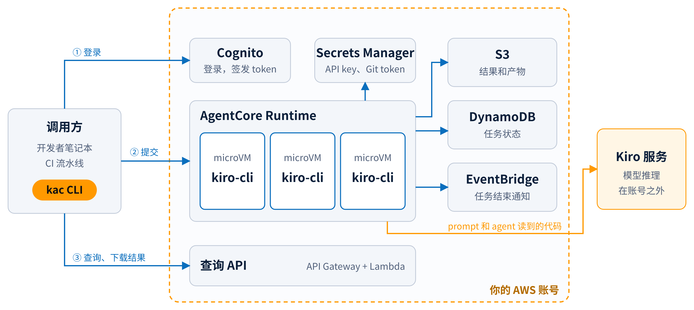

# kiro-cli on AWS AgentCore

把 kiro-cli 以 headless 模式运行在 Amazon Bedrock AgentCore Runtime 上，提供一个异步的远程 agent 服务。每个任务在独立的 microVM 中运行，有两种方式（`kac submit --loop-mode`）：

- **`none`（默认）**：kiro-cli 直接运行一次完成任务，最快最省；验收标准交给 agent 自查，不做独立验证。
- **`process` / `subagent`**：按闭环执行，交付结果经过独立验证：

```
UNDERSTAND（理解需求）→ PLAN（规划）→ EXECUTE（执行）→ VERIFY（独立验证）→ 决策
                ↑               ↑               ↑                          │
                └───────────────┴───────────────┴──── 验证未通过时回退 ────┘
```

闭环模式下：
- 阶段顺序、回退和轮次由代码控制。每个阶段单独运行一次 kiro-cli，阶段之间通过 JSON 文件交接，并做校验。
- 验证阶段使用全新上下文，看不到执行阶段的自述，必须逐条给出证据。全部验收标准通过才算成功。
- 需求不明确时，agent 自行澄清并记录假设，不向人提问。

所有方式：
- 结果写入 S3，状态记录在 DynamoDB，任务结束时向 EventBridge 发布事件。
- 本地用 `kac` 命令行提交任务、查询状态和下载结果，鉴权使用 Cognito OAuth。



所有资源部署在你自己的 AWS 账号里；模型推理由 Kiro 服务完成，任务的 prompt 和 agent 读到的代码会发送过去（见 [docs/security.md](docs/security.md)）。

## 目录

| 路径 | 内容 |
|---|---|
| `runtime/` | AgentCore 容器：Python wrapper、闭环编排器、4 个阶段的 kiro agent 配置、Dockerfile |
| `lambdas/` | Query API 和 Sweeper 两个 Lambda |
| `infra/` | CDK (TypeScript) stack |
| `cli/` | `kac` 命令行工具 |
| `scripts/` | `bootstrap.sh`（前置检查与 secret 引导）、`smoke_test.sh`（部署后冒烟测试）、`local_loop_check.py`（本地容器内跑一次真实闭环）、`cloudshell-sim/`（模拟 CloudShell 测试安装向导） |
| `install.sh`、`deploy/` | CloudShell 交互式安装向导，以及它使用的 CodeBuild 安装器 |
| `docs/` | 部署文档、kac 使用说明、安全说明、成本估算、技术验证结论 |
| `demo/` | 给客户演示用的材料：演示脚本、示例任务，以及演示视频和方案介绍 PPT 的生成脚本 |
| `.kiro/specs/kiro-cli-on-agentcore/` | 需求、设计、任务清单 |

## 快速开始

**推荐方式**：在 AWS CloudShell 中运行交互式安装向导，全程只需要浏览器。详见 [docs/cloudshell-install.md](docs/cloudshell-install.md)。

```bash
git clone <仓库地址> kiro-cli-on-agentcore && cd kiro-cli-on-agentcore   # 或上传并解压 zip 包
./install.sh
```

**开发者方式**：在本机部署，需要 Docker、Node.js 和 Python 3.12。

```bash
scripts/bootstrap.sh                       # 检查工具、AWS 身份、CDK bootstrap，引导创建 secret
cd infra && npm ci && npx cdk deploy       # 部署到 us-east-1
cd ../cli && uv tool install --python 3.12 '.[aws]'   # 安装 kac
kac configure --from-stack KiroAgentCoreStack
kac login
kac models                                 # 查看可用模型（Claude、GPT 等，取决于 Kiro API key）
kac submit "..." --kiro-dir ~/.kiro --agent my-agent   # 带上本地的 MCP、skills、steering 和 agent
kac submit "修复 issue #12 并提 PR" --context "仓库: https://github.com/org/repo" --ac "所有现有测试通过" --loop-mode process   # 需要独立验证时用闭环
kac wait <task_id> && kac result <task_id>
```

## 文档

| 文档 | 读者 |
|---|---|
| [docs/cloudshell-install.md](docs/cloudshell-install.md) | 不熟悉 AWS 的客户：在 CloudShell 中一步步安装、登录、提交第一个任务、升级、卸载 |
| [docs/kac.md](docs/kac.md) | 所有使用者：kac 命令、退出码、错误码 |
| [docs/deployment.md](docs/deployment.md) | 开发者和运维：本机部署、部署参数、日志与指标、并发配额 |
| [docs/security.md](docs/security.md) | 安全和合规评审：数据流向、权限边界、已知风险、责任划分、上线前检查清单 |
| [docs/cost.md](docs/cost.md) | 技术和预算负责人：费用构成、实测数据、月度估算、控制成本的方法 |
| [docs/spike-findings.md](docs/spike-findings.md) | 开发者：kiro-cli headless 和 AgentCore 的技术验证结论 |
| [CHANGELOG.md](CHANGELOG.md) | 所有人：各版本的变化，升级前请先看"不兼容的变化" |
| [.kiro/specs/kiro-cli-on-agentcore/](.kiro/specs/kiro-cli-on-agentcore/) | 开发者：需求、设计、任务清单 |

## 开发

```bash
make install   # 安装各子项目依赖
make lint      # ruff + tsc
make test      # 全部单元测试
make image     # 本地构建 linux/arm64 镜像
```

## 安全须知

kiro-cli 以 `--trust-all-tools` 运行，agent 可以在容器内执行任意命令。安全边界依靠以下几点：

- **任务默认没有 AWS 权限**：执行角色只有服务自身需要的权限（读两个 secret、写任务表、写产物 bucket、发事件），并显式 Deny IAM、AssumeRole、S3 删除、secret 修改等操作。需要让任务查询 AWS 时，部署时用 `agentAwsAccess` 按需开启：`viewonly`（只看资源配置）、`readonly`（全账号只读）或自己的托管策略 ARN。
- **服务数据不对任务开放**：无论开启哪种权限，任务都不能扫描任务表、下载产物 bucket 里的文件、读取本服务的日志或访问本服务的 Cognito 用户池。
- **microVM 隔离**：每个任务一个 microVM，任务结束 5 分钟后回收。
- **凭证最小化**：Git token 只授权给 agent 需要操作的仓库，建议使用 fine-grained token。
- **同步的 kiro 配置**：`--kiro-dir` 带上的 MCP server 在 microVM 里以同样的权限运行，可以使用执行角色的权限和任务环境变量。只同步可信的配置。MCP 配置里的明文密钥会随任务传输，最好改用 `${VAR}` 并放到任务环境变量 secret 里。

完整说明见 [docs/security.md](docs/security.md)：数据流向、权限边界、风险与缓解、上线前检查清单。

已知风险：仓库内容里的 prompt injection 可能让 agent 执行恶意命令、外传容器内的凭证，或改写本服务自己的任务记录和产物。所有任务共用同一个 Kiro API key，用量和限流会集中在这个 key 上。闭环模式下，每个任务至少运行 4 次 kiro-cli。
