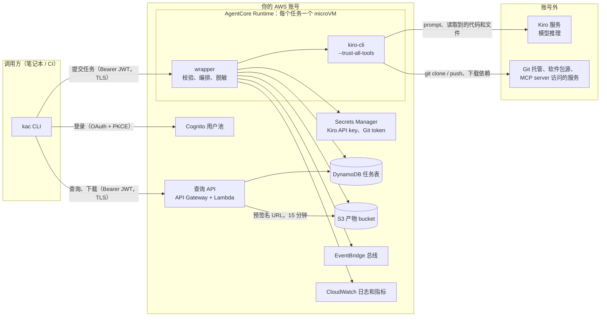

# 安全说明

读者：负责评审这套方案的安全、合规和平台团队。本文说明数据去了哪里、任务能做什么、有哪些已知风险，以及上线前要确认的事项。

本文对应版本 0.3.0。

## 一页摘要

| 问题 | 回答 |
|---|---|
| 部署在哪里 | 全部部署在你自己的 AWS 账号（us-east-1），由 CloudFormation 管理，可以完整卸载 |
| 哪些数据会离开账号 | 任务的 prompt，以及 agent 在执行中读取的代码和文件内容，会发送到 Kiro 服务做模型推理。agent 访问的 Git 仓库、软件包源等也是账号外的服务 |
| 任务默认能访问账号里的什么 | 默认没有访问你业务资源的权限。执行角色只有服务自身和 AgentCore 平台运行需要的权限 |
| 任务之间是否隔离 | 每个任务一个独立的 microVM，任务结束 5 分钟后回收。任务不能扫描任务表、下载产物 bucket 或读取本服务的日志 |
| 谁能提交任务 | 只有管理员在 Cognito 用户池里创建的用户，以及持有 machine client 密钥的系统。没有自助注册 |
| 谁能看任务结果 | 只有提交者本人（按 JWT 的 `sub` 判断）。账号管理员可以通过 S3 和 DynamoDB 直接看到全部任务 |
| 数据保留多久 | 任务记录和产物 90 天，日志 30 天（在 CDK 代码中设置） |
| 最需要注意的风险 | agent 以 `--trust-all-tools` 运行，可以在 microVM 内执行任意命令并访问公网。任务读到的内容里如果有 prompt injection，可能外传 Kiro API key 和 Git token。见"已知风险" |

## 架构与信任边界

信任边界有三条：

1. **调用方到服务**：AgentCore 和 API Gateway 校验 Cognito 签发的 JWT（签名、签发方、有效期、client、scope）。没有有效 token 的请求到不了容器。
2. **wrapper 到 agent**：wrapper 是本项目的代码，行为确定；kiro-cli 是由模型驱动的 agent，行为取决于 prompt 和它读到的内容。两者在同一个 microVM 里，使用同一个执行角色，所以**执行角色的全部权限都要按"agent 可以使用"来评估**。
3. **账号到外部**：microVM 使用公网模式，出站不受限制。

## 数据流向与存放

| 数据 | 存放位置 | 加密 | 保留 | 谁能读 |
|---|---|---|---|---|
| prompt、context、验收标准 | 产物 bucket（`loop/input.json`）；任务表只存 prompt 前 200 个字符 | SSE-S3；DynamoDB 用 AWS 托管密钥 | 90 天 | 提交者（通过查询 API）；账号管理员 |
| 任务结果和产物（`output.md`、`result.json`、`artifacts/`） | 产物 bucket | SSE-S3，仅 TLS，禁止公开访问 | 90 天后自动删除 | 同上 |
| 任务状态、阶段历史、credits 用量 | DynamoDB 任务表 | AWS 托管密钥，开启 PITR | 90 天（TTL） | 同上 |
| 运行日志（工具调用只记工具名和参数摘要） | CloudWatch Logs | CloudWatch 默认加密 | 30 天 | 账号内有日志读权限的身份 |
| Kiro API key；Git token 和任务环境变量（同在第二个 secret 里） | Secrets Manager，共两个 secret | KMS（默认 `aws/secretsmanager`） | 由你管理 | 执行角色（只限这两个 secret）；账号管理员 |
| 工作目录里的代码 | microVM 本地磁盘 | — | 任务结束后随 microVM 回收 | 只有该任务 |
| 登录 token | 调用方本机 `~/.config/kac/`，文件权限 0600 | — | access token 1 小时，refresh token 30 天 | 调用方本人 |
| 发往 Kiro 服务的内容 | Kiro 服务 | TLS 传输 | 见 Kiro 的服务条款 | 见 Kiro 的服务条款 |

说明：

- **发往 Kiro 服务的内容不在本方案的控制范围内。** 这部分数据如何处理、保留多久、是否跨境，以 Kiro 的服务条款和你与 AWS 的协议为准。对数据出境有要求的团队，请在使用前单独确认这一项，并据此决定哪些仓库可以交给这个服务处理。
- 写入日志、任务表和产物的文本，在写出前都会把已知的 secret 值替换为 `***REDACTED***`。这只能防止凭证意外出现在输出里，防不了恶意外传。
- `kac submit --kiro-dir` 会把本地的 MCP、skills、steering 和 agent 配置打包随任务上传（压缩后不超过 5 MB）。配置里的明文密钥会随之传输，建议改用 `${VAR}` 引用，值放在服务端的任务环境变量 secret 里。

## 身份与访问控制

- **用户**：Cognito 用户池关闭自助注册，用户由管理员创建。密码至少 12 位，要求大小写、数字和符号。MFA（TOTP）可选开启。
- **人工登录**：`kac login` 使用 OAuth 授权码流程加 PKCE，没有 client secret。
- **系统调用**：CI 等系统使用 client_credentials 流程，每个系统一个 machine client，密钥可以单独吊销。
- **授权**：提交和查询都要求 scope `kiro-agent/invoke`。查询 API 只返回 `owner` 等于调用者 `sub` 的任务，查询别人的任务返回 404。
- **下载**：产物通过预签名 URL 下载，有效期 15 分钟。
- **限流**：查询 API 每秒 20 次，突发 40 次。并发任务数受账号的 AgentCore 配额限制。

当前版本没有按用户的配额和审批流程：拿到账号的用户都可以提交任务、使用允许列表内的任意模型。

## 任务的权限边界

### 执行角色

| 权限 | 范围 | 用途 |
|---|---|---|
| `secretsmanager:GetSecretValue` | 只限 Kiro API key 和 Git 凭证两个 secret | 启动 kiro-cli |
| `dynamodb:GetItem / PutItem / UpdateItem` | 只限任务表 | 记录任务状态 |
| `s3:PutObject` | 只限产物 bucket | 上传结果 |
| `events:PutEvents` | 只限本服务的总线 | 任务结束通知 |
| 写日志、trace、指标，拉取镜像，获取 workload token | AgentCore 运行所需。其中包括列出账号内日志组的名称（`logs:DescribeLogGroups`） | 平台 |
| **任务的 AWS 权限** | **默认没有**，见下表 | 运维类任务 |

显式 Deny，任何设置下都生效：

- `iam:*`、`organizations:*`、`sts:AssumeRole`
- `s3:DeleteObject*`、`s3:PutBucket*`、`s3:DeleteBucket*`
- `secretsmanager:CreateSecret / PutSecretValue / UpdateSecret / DeleteSecret`
- `dynamodb:DeleteTable`、`dynamodb:DeleteItem`
- 任务表上除按主键读写单条记录以外的全部操作（不能 Scan、Query、导出）
- 产物 bucket 上除上传以外的全部操作（不能列出、下载）
- 本服务的日志组上除写日志以外的全部操作（日志里有 task_id，读到它就能按主键读到别的任务记录）
- 本服务 Cognito 用户池上的全部操作（machine client 的密钥可以通过 `DescribeUserPoolClient` 读到）
- 所有 AgentCore Runtime 的日志组和 `aws/spans` 上除写日志以外的全部操作，以及读取 X-Ray trace（这些地方记录了任务的 prompt 和工具调用）

后四条的目的是：即使给任务开启了读权限，它也读不到其他任务的数据，拿不到调用本服务的凭证。

### 任务的 AWS 权限（`agentAwsAccess`）

| 取值 | 任务能做什么 | 适用场景 | 开启前要考虑 |
|---|---|---|---|
| `none`（默认） | 不能访问你的 AWS 资源 | 代码类任务：改代码、跑测试、提 PR、写文档 | — |
| `viewonly` | 列出和查看资源配置（`job-function/ViewOnlyAccess`）。读不到 S3 对象、DynamoDB 数据、日志内容 | 资源盘点、架构梳理、配置巡检 | 资源名称、标签、网络拓扑等配置信息会进入 prompt，发送到 Kiro 服务。配置里的内容也在可见范围内，例如 Lambda 函数的环境变量；写在环境变量里的密钥会被读到 |
| 托管策略 ARN | 你的策略允许的操作 | 只让 agent 读某几个服务或某些资源，例如指定的日志组 | AWS 托管策略只接受名称表明只读的（如 `AmazonS3ReadOnlyAccess`），其他的会在部署时被拒绝。只读不等于无害：例如 `AmazonSSMReadOnlyAccess` 能读到 SSM 参数里的密钥，`CloudWatchLogsReadOnlyAccess` 能读到其他应用的日志。自己创建的策略不检查内容，由你负责 |
| `readonly` | 全账号只读（`ReadOnlyAccess`），包括 S3 对象、DynamoDB 数据、日志、trace、Lambda 代码和环境变量，以及其他服务配置里的凭证（例如别的 Cognito 用户池的 client secret、未加密的 SSM 参数） | 排查问题需要读数据的运维任务 | 账号里所有可读的数据都可能进入 prompt。只建议用在没有敏感数据、且所有使用者互相信任的专用账号，否则改用自定义策略 |

选择建议：从 `none` 开始。确实需要让 agent 查询 AWS 时，优先写一个自定义策略；其次用 `viewonly`；`readonly` 只用在专门的运维账号或沙箱账号。

修改方式：`./install.sh --aws-access <取值>`，或 `npx cdk deploy -c agentAwsAccess=<取值>`。

## 隔离

- 每个任务运行在独立的 AgentCore microVM 中，一个 Session 只运行一个任务。任务结束后 Session 空闲 5 分钟被回收，最长存活 8 小时。
- 同一时间运行的任务之间不共享文件系统、进程和内存。
- 所有任务共用同一个执行角色和同一组 secret，没有各自独立的 IAM 身份。microVM 和上面的显式 Deny 保证的是**一个任务读不到另一个任务的数据**；它们不保证完整性：知道某个 task_id 的任务可以改写那条任务记录、覆盖它的产物（见"已知风险"）。

## 网络

- Runtime 使用公网模式。入站只能通过 AgentCore 的调用接口，并且需要有效的 JWT。
- **出站不受限制。** agent 可以访问任意公网地址，这是克隆仓库、安装依赖所需要的，也意味着被注入的任务可以向外发送数据。
- 当前版本不支持部署到 VPC。需要限制出站目的地或访问内网资源（内网 Git、制品库）的场景，需要改为 VPC 模式并配合出站代理，这是后续工作。

## 日志与审计

- wrapper 的结构化日志进入 CloudWatch Logs，每条带 `task_id`、`session_id` 和阶段。工具调用只记录工具名和参数摘要。
- 执行角色发出的 AWS API 调用由 CloudTrail 记录，可以按角色名筛选出 agent 做过的操作。
- 每个任务的提交者、模型、耗时、credits 用量和结果记录在任务表中。
- 任务结束时向 EventBridge 总线 `kiro-agentcore` 发布 `TaskCompleted` 事件，可以接到你的通知或审计系统。

## 已知风险与缓解

| 风险 | 影响 | 已有的缓解 | 建议你做的 |
|---|---|---|---|
| **Prompt injection**：仓库内容、网页、issue 里的恶意指令被 agent 当成任务执行 | 在 microVM 内执行任意命令；外传 Kiro API key、Git token 和任务读到的内容 | 任务默认没有 AWS 权限；microVM 隔离；显式 Deny | 只处理可信的仓库；Git token 用 fine-grained token，只授权需要的仓库和最小权限；对外部贡献者的 PR 和 issue 不要直接交给 agent |
| **凭证对 agent 可见**：Kiro API key 和 Git token 以环境变量形式交给 kiro-cli | 被注入后可能外传 | 输出脱敏；secret 只限两个 | 定期轮换；Git token 设置有效期；发现异常立即吊销 |
| **agent 可以改写任务记录和产物**：agent 与 wrapper 共用执行角色，知道 task_id 就能改写对应的任务记录、覆盖产物 | 任务状态或结果被篡改 | task_id 是随机 ID；任务表禁止 Scan / Query，本服务的日志对任务不可读，任务无法从这些地方得到别人的 task_id | 把结果当作需要复核的产出，重要变更通过 PR 评审合入 |
| **出站不受限制** | 数据外传没有网络层的拦截 | — | 敏感仓库暂不接入；需要时规划 VPC 模式 |
| **共用 Kiro API key** | 用量和限流集中在一个 key 上；无法按用户区分 Kiro 侧的用量 | 任务表记录每个任务的 credits | 用任务表数据做内部分摊；为这个服务单独申请一个 key；确认订阅条款允许多人共用 |
| **验证偏差**：闭环模式下验证阶段与执行阶段用同一个模型 | "验证通过"不等于一定正确 | 验证阶段使用全新上下文，必须逐条给出证据 | 保留人工评审；关键仓库开启分支保护 |
| **同步的 MCP server**：`--kiro-dir` 带上的 MCP server 在 microVM 内运行 | 恶意或有漏洞的 MCP server 拥有和 agent 相同的权限 | 压缩包做大小、路径和成员检查 | 只同步可信的配置 |

## 责任划分

| 事项 | 本方案 | 你 |
|---|---|---|
| 基础设施的安全配置（加密、禁止公开访问、TLS、最小权限的执行角色） | ✓ | |
| 身份认证和任务归属隔离 | ✓ | |
| 输出脱敏 | ✓ | |
| 创建和管理用户，决定谁能用 | | ✓ |
| Kiro API key 和 Git token 的申请、权限范围和轮换 | | ✓ |
| 决定 `agentAwsAccess` 的取值，以及自定义策略的内容 | | ✓ |
| 决定哪些仓库和数据可以交给 agent 处理 | | ✓ |
| 确认 Kiro 服务的数据处理条款符合合规要求 | | ✓ |
| 评审和合入 agent 的产出 | | ✓ |

本项目以示例代码的形式提供，用于概念验证和评估。用于生产前，请按你所在组织的安全标准完成评审和加固。

## 上线前检查清单

- [ ] 已确认 Kiro 服务的数据处理条款，并明确哪些仓库可以接入
- [ ] `agentAwsAccess` 保持 `none`，或已评审所选策略的内容
- [ ] Git token 是 fine-grained token，只授权需要的仓库，设置了有效期
- [ ] 目标仓库开启了分支保护，agent 的改动通过 PR 评审合入
- [ ] 为这个服务使用单独的 Kiro API key，并已确认 Kiro 的订阅条款允许这种用法（多人通过一个服务共用 API key、无人值守运行）
- [ ] 用户池只有需要使用的人，已按需要开启 MFA
- [ ] 每个 CI 系统使用各自的 machine client
- [ ] 已订阅 `TaskCompleted` 事件或建立其他方式查看任务情况
- [ ] 已为执行角色的 CloudTrail 记录设置保留期
- [ ] 部署在专用账号或沙箱账号（建议）

## 常见问题

**代码会被用来训练模型吗？**
这取决于 Kiro 服务的条款，不由本方案决定。请向 Kiro 或你的 AWS 客户团队确认当前条款和可用的设置。

**能不能不让数据离开账号？**
不能。模型推理由 Kiro 服务完成，prompt 和 agent 读取的内容必须发送过去。

**能不能部署在其他区域？**
当前版本固定部署在 us-east-1。

**任务能看到其他人的任务吗？**
通过查询 API 不能。任务内部的 agent 不能扫描任务表，不能列出或下载产物 bucket，也读不到本服务的日志。知道某个 task_id 时，agent 可以读到并改写那条任务记录（状态、prompt 前 200 个字符等元数据），读不到产物。

**agent 会修改我的 AWS 资源吗？**
默认不能，执行角色没有相应权限。开启 `viewonly` 或 `readonly` 后也只有读权限，并且显式拒绝 IAM、AssumeRole 等操作。使用自定义策略时，权限以你的策略为准。

**怎样停掉一个正在运行的任务？**
当前版本没有取消命令。任务到超时时间会被终止（默认 2 小时，提交时可以用 `--timeout` 指定更短的时间）。在 Kiro 侧吊销 API key 可以阻止新的模型调用。

**怎样完整卸载？**
删除 `KiroAgentCoreStack` 和 `KiroAgentCoreInstaller` 两个 stack。用户池、任务表、产物 bucket 和日志组会保留，需要时手动删除。见 [cloudshell-install.md](cloudshell-install.md#卸载)。
